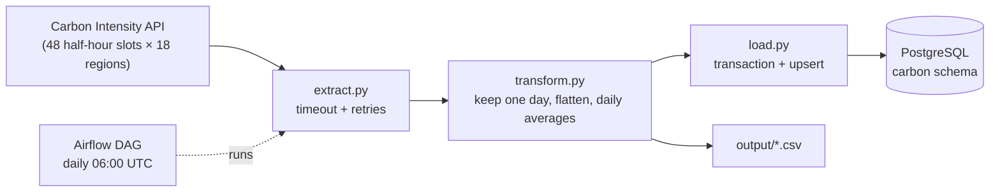

# UK Carbon Intensity Pipeline

[](https://github.com/Kolawole162/uk_carbon_intensity_pipeline/actions/workflows/ci.yml)

A daily ETL pipeline that pulls half-hourly carbon intensity and generation-mix data for 18 UK
electricity regions from the public [Carbon Intensity API](https://carbonintensity.org.uk/),
aggregates it to one row per region per day, and loads it into a PostgreSQL star schema.
It runs in Docker, is scheduled with Apache Airflow, and is tested on every push with
GitHub Actions.

## Architecture



**Tech stack:** Python · pandas · SQLAlchemy · PostgreSQL · Docker Compose · Apache Airflow 3 · pytest · GitHub Actions

## Data model

| Table | Grain | Contents |
|---|---|---|
| `carbon.dim_region` | one row per region | region id, short name, distribution network operator |
| `carbon.fact_carbon_intensity` | one row per region per day | average intensity (gCO₂/kWh) and most common intensity index; range-partitioned by year with a default partition |
| `carbon.fact_generation_mix` | one row per region per day | average share (%) of biomass, coal, imports, gas, nuclear, other, hydro, solar and wind |

The schema is in [`sql/schema.sql`](sql/schema.sql) and is created automatically when the
Postgres container first starts.

## Design decisions

- **Double-counted boundary interval fixed.** The API's `pt24h` endpoint returns **49** half-hour
  intervals, because it includes both ends of the window. One of them belongs to a neighbouring day
  and would be counted twice across consecutive runs. `keep_day()` keeps only the 48 intervals that
  start on the target day, and a unit test covers it.
- **Idempotent loads.** Each run deletes that day's rows and inserts fresh ones inside a single
  transaction, and regions are upserted with `ON CONFLICT … DO UPDATE`. Re-running a day replaces
  its data rather than duplicating it or failing on the primary key.
- **Reliable extraction.** Requests have a timeout and retry with back-off on network errors,
  rate limits (HTTP 429) and server errors (5xx); other errors fail immediately.
- **No secrets in code.** Database settings come from a `.env` file that is excluded from Git and
  from the Docker image. The connection URL is built with SQLAlchemy's `URL.create`, so special
  characters in passwords are handled safely.
- **Isolated dependencies in Airflow.** The pipeline runs in its own virtual environment inside the
  Airflow image, so its packages never conflict with Airflow's.

## Project structure

```
├── src/carbon_etl/
│   ├── extract.py        # API request with timeout and retries
│   ├── transform.py      # keep_day, flatten, aggregate_daily
│   ├── load.py           # idempotent PostgreSQL loader
│   ├── db.py             # engine built from environment variables
│   └── pipeline.py       # runs extract → transform → save CSV → load
├── dags/carbon_daily.py  # Airflow DAG, daily at 06:00 UTC with 2 retries
├── sql/schema.sql        # star schema
├── tests/                # pytest unit tests
├── Dockerfile            # pipeline image
├── Dockerfile.airflow    # Airflow image with a separate pipeline virtualenv
├── docker-compose.yml    # Postgres, pipeline and Airflow services
└── .github/workflows/ci.yml
```

## How to run

**1. Configure.** Copy `.env.example` to `.env` and set your database values:

```
DB_HOST=127.0.0.1
DB_PORT=5432
DB_USER=postgres
DB_PASSWORD='CHANGE_ME'
DB_NAME=carbon_pipeline
```

**2. Run with Docker** (Postgres and the pipeline in containers):

```bash
docker compose up -d postgres
docker compose run --rm pipeline 2026-11-01   # loads data for 2026-10-31
```

**3. Schedule with Airflow:**

```bash
docker compose up -d --build airflow
```

Open <http://localhost:8080>, switch on `uk_carbon_intensity_daily` and trigger a run.
The local setup disables Airflow login for convenience; it is not intended for production.

**Run locally without Docker** (needs a PostgreSQL database with `sql/schema.sql` applied):

```bash
python -m venv venv && venv\Scripts\activate      # Windows
pip install -r requirements.txt
set PYTHONPATH=src
python -m carbon_etl.pipeline 2026-11-01
```

## Tests and CI

```bash
pytest -v
```

Unit tests cover flattening, daily aggregation, previous-day labelling, the most common intensity
index, missing fuels and the boundary-interval filter. They use a small fake API response, so they
run without network access. GitHub Actions runs them on every push.

## Verified results

- One run for 2026-11-01 fetches 49 intervals, keeps 48 and loads 18 regions for 2026-10-31.
- Running the same day twice leaves exactly 18 rows for that date, not 36.
- The Airflow DAG runs successfully in Docker and is scheduled for 06:00 UTC daily.

## Possible next steps

- Split the Airflow DAG into separate extract, transform and load tasks.
- Add data-quality checks, for example that every region's fuel shares sum to about 100%.
- Add an integration test against a Postgres container in CI.
- Backfill historical data and add a dashboard.

## Data source

Data from the [Carbon Intensity API](https://carbonintensity.org.uk/). See the site for its terms of use.

## Author

Kolawole Samson Bolarinwa · [LinkedIn](https://linkedin.com/in/kolawole-bolarinwa-b1bb30138) · [GitHub](https://github.com/Kolawole162)
